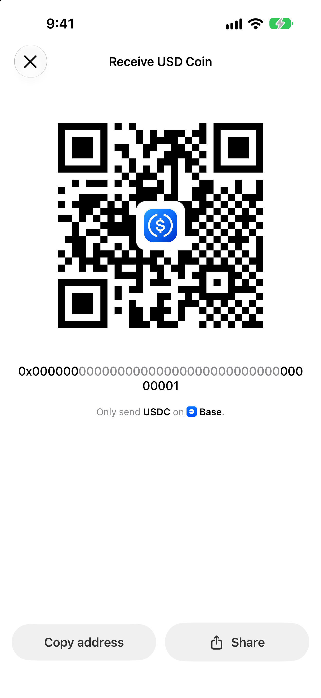

To send USDC from your Coinbase account to Oath using Base, select **USDC on Base** in Oath’s Receive screen. In Coinbase, make an on-chain send to that address and explicitly choose **Base**. Check the amount, recipient and fee in Coinbase’s preview before authorizing the send.

## Match native USDC and the Base network

| Check | Coinbase side | Oath side |
| --- | --- | --- |
| Asset | USDC | USD Coin / USDC |
| Network | Base | Base |
| Recipient | External crypto address | Your selected wallet’s receiving address |
| Token | Native USDC withdrawn on Base | Circle’s native Base USDC contract |

Circle’s Base USDC contract is `0x833589fcd6edb6e08f4c7c32d4f71b54bda02913`. It identifies the asset and **must not be used as the receiving address**. Check [Circle’s contract list](https://developers.circle.com/stablecoins/usdc-contract-addresses) and [Oath’s Base USDC page](https://oathwallet.org/tokens/usdc/base).

Coinbase’s [USDbC guidance](https://help.coinbase.com/en/coinbase/getting-started/crypto-education/usd-base-coin) distinguishes bridged USDbC from native USDC and says Coinbase withdrawals use native USDC. This guide covers a regular **Coinbase account**, not the self-custody Base app, Coinbase Prime or Coinbase International Exchange. Their screens and fee policies are separate.

The route must appear in your Coinbase send screen. Coinbase’s [multiple-network guidance](https://help.coinbase.com/en/coinbase/trading-and-funding/sending-or-receiving-cryptocurrency/assets-on-multiple-networks) notes regional restrictions, including that multi-network support is not available in New York. If Base is absent or unavailable, do not proceed using a different network under these instructions.

## 1. Copy the destination from Oath

Open the wallet that should receive the funds. Select **USD Coin (USDC) on Base**, then open **Receive**. Confirm the Base network label and copy the address from the app. An Ethereum address and a Base address can look identical; the network selection still determines where the funds arrive.

Actual Oath 5.0.2 (104) simulator capture with a mock address. Never send to the example address or QR code. Use the receiving details inside your own Oath wallet.

Keep the address available while you review Coinbase’s final destination. Do not use an address from an old message, a search result or a screenshot simply because it begins with `0x`.

## 2. Send from the Coinbase app or website

Coinbase documents both paths in [Steps to send crypto](https://help.coinbase.com/en/coinbase/trading-and-funding/cryptocurrency-trading-pairs/steps-to-send-crypto).

**In the Coinbase mobile app:** open **Pay**, select **USDC**, enter the amount and continue with **Pay**. Enter the Oath crypto address, choose **Base** in the network selector, review the details, then use **Pay now** only after they match. Complete two-step verification if prompted.

**On Coinbase.com:** choose **Send crypto** from the dashboard, select USDC and the amount, then use **To** to choose the network and add the address. Select **Base**, review **Preview Send**, and confirm with **Send now** when correct.

This journey uses a blockchain address. A Coinbase-to-Coinbase send to a phone number or email is a different flow and will not deposit USDC into the Oath address. Do not substitute an email for the wallet destination.

## 3. Read the fee preview before confirming

Check the selected network, the amount sent, any fee and the total deducted. Coinbase’s [fee disclosures](https://help.coinbase.com/en/coinbase/trading-and-funding/pricing-and-fees/fees) say transaction fees are shown at the time of the transaction and can vary. A fee policy for another Coinbase product, region or promotion is not a quote for your send.

If your preview shows zero, that is the displayed fee for that send; this guide does not promise that every Base withdrawal is free. Buying or converting an asset before withdrawing can also involve separate charges. A test send should fit your available balance and any displayed minimum.

Once USDC is in Oath, a later ordinary outgoing Base transaction needs **ETH on Base** for gas. ETH on Ethereum does not pay that Base fee. You do not need to send ETH to the sender to receive a normal incoming USDC transfer. See [Base’s fee model](https://docs.base.org/specifications/transactions/network-fees).

## 4. Check that the payment arrived on Base

Open the send in Coinbase’s activity and use its transaction hash to view the blockchain record. On [BaseScan](https://basescan.org/), check the transaction result and the **USDC token transfer**: recipient, contract and amount. A token payment may show a zero ETH value in the transaction summary; the token-transfer section is the relevant amount.

In Oath, open the same wallet and USDC-on-Base entry, then refresh after confirmation. If you accidentally selected Ethereum in Coinbase, check the actual network of that transaction before looking for a Base balance. Switching networks in the wallet does not bridge the funds.

## If Coinbase says Pending

First separate an exchange delay from an on-chain transaction:

- **No transaction hash yet:** check Coinbase’s activity details, account notices and [service status](https://status.coinbase.com/). Oath cannot release funds still awaiting Coinbase processing.
- **A hash exists:** inspect the network and confirmation result. Coinbase’s [pending-transaction guide](https://help.coinbase.com/en/coinbase/trading-and-funding/sending-or-receiving-cryptocurrency/why-is-my-transaction-pending) identifies confirmation delays, network congestion and other processing causes.
- **The correct Base USDC transfer succeeded:** confirm the recipient belongs to the selected Oath wallet, refresh that asset and keep the public hash if support is needed.
- **You used an email or phone recipient:** check that separate Coinbase payment. Its acceptance or cancellation rules are not a way to cancel a broadcast blockchain transfer.

Avoid sending again to “unstick” the first withdrawal. A second successful send would be another payment. Do not send an extra payment to someone claiming they must unlock or validate your incoming funds.

## Review and next steps

Reviewed **November 9, 2026** against Coinbase’s consumer-account documentation, Circle’s token identity and [Oath 5.0.2 (104) receiving code](https://github.com/OathWallet/oath-wallet/blob/d039b009d8c81b0497f2ac7e6abebfdf54ff8612/OathAtmosphere/Home/OathReceiveSheet.swift). The screenshot uses mock data in the real app. This was a documentation and released-source review, not a funded Coinbase withdrawal or an individual account eligibility test.

This is Oath’s independent guide, not a Coinbase endorsement. Use official support for exchange account restrictions. Never share a recovery phrase, private key, password or two-factor code with support or this website.

[Get Oath for iPhone](https://apps.apple.com/us/app/oath-bitcoin-crypto-wallet/id6780187283) · [USDC on Base](https://oathwallet.org/tokens/usdc/base) · [Compare USDC networks](https://oathwallet.org/tokens/usdc) · [Check the network fee asset](https://oathwallet.org/networks/fees)
