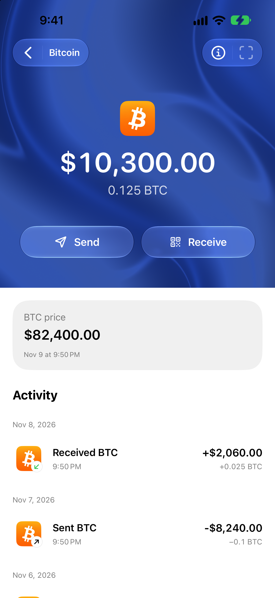

To withdraw Bitcoin from Kraken to Oath on iPhone, open **Bitcoin Receive** in Oath and copy your address. In Kraken, withdraw **BTC** using the **Bitcoin on-chain network**, paste that address and review the amount and fee. A Lightning withdrawal requires a different payment request and is outside this route.

## Choose Bitcoin on-chain at both ends

| Check | Kraken side | Oath side |
| --- | --- | --- |
| Asset | Bitcoin / BTC | Bitcoin / BTC |
| Network | Bitcoin on-chain | Bitcoin |
| Destination | A Bitcoin withdrawal address | Your own Bitcoin Receive address |
| Separate route | Lightning requires a Lightning request | These steps use an ordinary on-chain address |

Kraken’s [Bitcoin Lightning instructions](https://support.kraken.com/articles/5068216131988-how-do-i-send-bitcoin-on-the-lightning-network-) explicitly select Lightning and a Lightning request. That is not interchangeable with the address in this guide. Likewise, Bitcoin Cash and wrapped BTC on another chain do not become Bitcoin by using a similar name.

These steps cover the **Kraken interface at kraken.com**. Kraken Pro and the Krak app have separate navigation. Asset and network availability can depend on your account and location. Check Kraken’s withdrawal screen and [service status](https://status.kraken.com/) before starting.

## 1. Prepare your Bitcoin address in Oath

Open the intended Oath wallet, choose **Bitcoin**, and open **Receive**. Wait for the address to be ready. If that wallet offers address types, use one accepted by Kraken and copy it directly from Oath; do not rewrite an address to make it look like another type.

Keep your recovery method available before receiving funds. You are transferring BTC into a wallet you control, not importing your Kraken login or transferring an exchange account. The [Oath Bitcoin guide](https://oathwallet.org/networks/bitcoin) explains the receiving flow and account checks.

## 2. Create the withdrawal in Kraken

Kraken’s [current web instructions](https://support.kraken.com/articles/360000672763-how-to-withdraw-cryptocurrencies-from-your-kraken-account) use **Portfolio → Withdraw**:

1. Select **Bitcoin / BTC**, then choose the **Bitcoin** on-chain network.
2. Add or select your own Oath receiving address. Compare the full pasted destination with the app.
3. Enter an amount that meets Kraken’s displayed minimum and leaves room for the fee.
4. Review the network, destination, recipient amount and total deduction. Confirm only after they match.
5. Complete any requested security verification. Kraken notes that funding 2FA, when enabled, can differ from sign-in 2FA.

The linked Kraken walkthrough includes its own screenshots. Follow prompts for your actual interface; do not assume an old tutorial’s address-confirmation email or menu is required. Kraken directs users of this interface to track the withdrawal in recent activity.

## 3. Check the withdrawal fee, minimum and available balance

Kraken has a [withdrawal-fee and minimum guide](https://support.kraken.com/articles/360000767986-cryptocurrency-withdrawal-fees-and-minimums), but says the confirmation screen provides the final fee and that amounts can change. Use that screen rather than a fixed number copied from an older article. If it shows separate requested and recipient amounts, distinguish them before confirming.

Some funding methods cause withdrawal holds. Kraken’s [withdrawal instructions](https://support.kraken.com/articles/360000672763-how-to-withdraw-cryptocurrencies-from-your-kraken-account) describe holds after certain purchases or deposits. A trading balance is therefore not always immediately withdrawable. Read the release time in your account; Oath cannot remove an exchange hold.

For a first transfer, choose a small amount that still meets the minimum after applying the form’s fee rules. A later withdrawal can incur another fee. Sending BTC onward from Oath is also a separate transaction with its own Bitcoin network fee.

## 4. Follow the transaction after broadcast

Open Kraken’s withdrawal details. When a transaction ID is available, follow its explorer link or use a Bitcoin explorer such as [mempool.space](https://mempool.space/). Check that it is on Bitcoin mainnet, identify the output paying your Oath address and compare its BTC amount. An exchange transaction can contain payments to several recipients; the total transaction value is not necessarily your withdrawal amount.

A broadcast transaction may initially have no confirmations. Inclusion in a block and later confirmations are separate stages. Check the transaction’s current status, then refresh the intended Bitcoin wallet in Oath. See the [Bitcoin developer payment guide](https://developer.bitcoin.org/devguide/payment_processing.html) for the distinction between an unconfirmed payment and a confirmed one.

Actual Oath 5.0.2 (104) simulator capture with mock balances, prices and activity. This is an illustration of the receiving wallet’s asset screen, not a completed Kraken withdrawal. Never send funds using an address from an example image.

## If Kraken shows Pending, On hold or Failed

Kraken’s [withdrawal-status reference](https://support.kraken.com/articles/360000674046-cryptocurrency-withdrawal-statuses) is specifically labelled for **Kraken Classic**. If those labels appear in your withdrawal record, interpret them as follows:

| Status | What to check next |
| --- | --- |
| Initiated / Pending | Kraken is performing checks or processing the request. Look for account notices and a transaction ID; it may not be on-chain yet. |
| Sending | The transaction has been broadcast and is waiting for a blockchain confirmation. Inspect the transaction ID. |
| Success | Kraken’s reference says it has one network confirmation. Verify your destination output and Oath account. |
| On hold | Contact Kraken through official support for its manual review. |
| Failed | Open the withdrawal details and read the error before retrying. |

Other interfaces may use different wording. Read the actual withdrawal details instead of translating a label by guesswork. Kraken documents limited cancellation requests before broadcast in its Classic flow; a pending cancellation request is not a guarantee. Do not assume a confirmed on-chain withdrawal can be cancelled.

If the correct output is confirmed but Oath is not showing it, refresh the selected Bitcoin wallet and keep the public transaction ID for support. If the network or destination is wrong, stop and ask the relevant service about its recovery options. Do not delete a wallet, reveal recovery material or repeat a payment to fix a display delay.

## Review and next steps

Reviewed **November 9, 2026** against the linked Kraken documentation and [Oath 5.0.2 (104) receiving implementation](https://github.com/OathWallet/oath-wallet/blob/d039b009d8c81b0497f2ac7e6abebfdf54ff8612/OathAtmosphere/Home/OathReceiveSheet.swift). The screenshot is an actual simulator capture with mock data. We did not execute a funded Kraken withdrawal or test an individual Kraken account’s eligibility.

Oath publishes this independent guide without implying a Kraken partnership. Share only the public transaction information needed for a support investigation; keep recovery credentials and exchange authentication codes private.

[Get Oath for iPhone](https://apps.apple.com/us/app/oath-bitcoin-crypto-wallet/id6780187283) · [Bitcoin on Oath](https://oathwallet.org/networks/bitcoin) · [Choose the right network](https://oathwallet.org/networks/choose-token-network) · [Understand pending and confirmed activity](https://help.oathwallet.org/articles/transaction-status)
