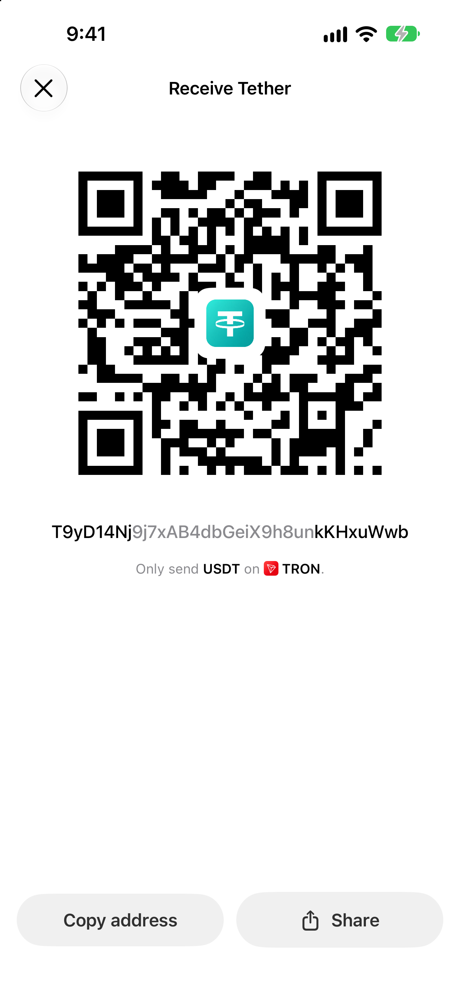

To withdraw USDT from Binance to Oath on TRON, get your **USDT on TRON** receiving address in Oath, then choose **USDT** and the **TRON / TRC20** network in Binance. Review the destination, withdrawal fee and amount the recipient will receive before confirming. This route is an on-chain withdrawal to your own wallet.

## Check that this is your route

| Check | Binance side | Oath side |
| --- | --- | --- |
| Asset | USDT | Tether (USDT) |
| Network | TRON / TRC20; TRX in Binance’s network-status list | TRON |
| Destination | Your external wallet address | The address from your own Receive screen |
| Token identity | USDT supported on that network | Tether’s TRON contract below |

Tether identifies TRON USDT by the contract `TR7NHqjeKQxGTCi8q8ZY4pL8otSzgjLj6t`. **That contract is not your receiving address.** Compare it with [Tether’s supported protocols](https://tether.to/en/supported-protocols/) and [Oath’s USDT on TRON guide](https://oathwallet.org/tokens/usdt/tron).

This guide covers the Binance exchange app, not Binance.US or Binance Wallet. Binance’s [withdrawal announcement](https://www.binance.com/en/square/post/383446817991353) includes USDT on TRX/TRON, but eligibility and availability can change. Check the USDT withdrawal screen and [network-status page](https://www.binance.com/en/network). If this route is suspended or unavailable for your account, stop; selecting an unrelated network is not a substitute.

## 1. Prepare the receiving side in Oath

Open the intended wallet in Oath. Find **Tether (USDT) on TRON**, open **Receive**, and check the network warning beneath the QR code. Use **Copy address** to obtain your personal destination. If you have several wallets, compare the selected wallet before returning to Binance.

Actual Oath 5.0.2 (104) simulator capture with a mock address. Never send funds to the address or QR code in this screenshot. Copy from your own wallet inside Oath.

A regular Binance exchange balance cannot be imported into Oath with an exchange password. Withdrawal moves assets to the receiving wallet; it does not transfer your Binance account, trading history or security settings. Have access to your Oath wallet’s recovery method before using it for funds you need to keep.

## 2. Set up the withdrawal in Binance

The [current Binance app instructions](https://www.binance.com/en/support/faq/detail/115003670492) use this sequence:

1. Open **Assets → Overview → Send → Withdraw Asset**.
2. Choose the funding account and **USDT**.
3. Paste your Oath address and select **TRON / TRC20**. Check the network yourself even if Binance selects it automatically.
4. Enter the amount and check the displayed withdrawal fee and recipient amount. Choose a one-time withdrawal for this journey.
5. Compare the complete address with Oath, then review and complete Binance’s requested passkey or two-factor verification only when every detail matches.

The linked Binance guide includes its own interface screenshots. Labels can differ by app version and region. You are sending to an external address, not to another Binance user by email, phone number or ID.

## 3. Understand the amount and the two different fees

Binance’s form can calculate from either **Receive amount** or **Withdrawal amount**. One starts from what the recipient should get; the other starts from the total deducted. Read both totals rather than assuming that entering “100” always delivers 100 USDT.

Binance publishes [withdrawal-fee information](https://www.binance.com/en/fee/cryptoFee), but the fee and minimum shown for your asset and network at confirmation are the values to use. This guide does not quote a fixed USDT fee. A small first withdrawal should meet the displayed minimum and leave a useful amount after any fee; another withdrawal may incur another charge.

That exchange withdrawal fee is separate from sending USDT later **from Oath**. TRON uses Energy and Bandwidth; insufficient resources can require TRX. Receiving USDT does not guarantee you have enough resources for a later send. Review Oath’s estimate for that later transaction. See [TRON’s resource model](https://developers.tron.network/docs/resource-model).

## 4. Confirm the transfer on TRON and in Oath

Open the withdrawal record in Binance. Once it supplies a **TxID**, use its explorer link or [TRONSCAN](https://tronscan.org/) to inspect the transfer. Check the network, transaction result, recipient, USDT contract and amount. A TxID identifies a transaction; its existence alone does not establish a successful token transfer.

Return to the same Oath wallet and USDT-on-TRON asset. Refresh the balance and activity after the chain confirms the transfer. Compare the amount received with Binance’s final recipient amount, not just the original amount you entered.

## If the withdrawal is pending or missing

- **Processing in Binance, with no TxID:** the withdrawal may still be with the exchange. Check Binance’s status and account notices. Oath cannot broadcast or speed up a withdrawal held by Binance.
- **A TxID exists but the transaction is not confirmed:** follow its network status. Do not repeat the withdrawal merely because the first payment is still pending.
- **Binance says Completed:** inspect the TxID, then verify the recipient and token transfer. If those match and Oath has not refreshed, keep the public transaction ID for Oath support.
- **Wrong network, destination or token:** stop before another payment. Contact the relevant service about the actual transaction. Recovery is not guaranteed.

Binance describes these stages in [Why hasn’t my withdrawal arrived?](https://www.binance.com/en/support/faq/detail/115003743192). A Binance status label and Oath’s displayed balance are different observations; checking the chain helps locate where the delay is.

## Review and next steps

Reviewed **November 9, 2026** against the linked exchange documentation, token issuer information and [Oath 5.0.2 (104) receiving implementation](https://github.com/OathWallet/oath-wallet/blob/d039b009d8c81b0497f2ac7e6abebfdf54ff8612/OathAtmosphere/Home/OathReceiveSheet.swift). The image shows the real app with mock data. We did not perform a funded Binance withdrawal for this guide or verify availability inside an individual Binance account.

Oath publishes this guide independently; it does not imply a Binance partnership. Use the exchange’s official app or support links for account verification. Neither this page nor an Oath support conversation needs your recovery phrase, private key or exchange authentication code.

[Get Oath for iPhone](https://apps.apple.com/us/app/oath-bitcoin-crypto-wallet/id6780187283) · [USDT on TRON](https://oathwallet.org/tokens/usdt/tron) · [Choose the right token network](https://oathwallet.org/networks/choose-token-network) · [Understand transaction status](https://help.oathwallet.org/articles/transaction-status)
